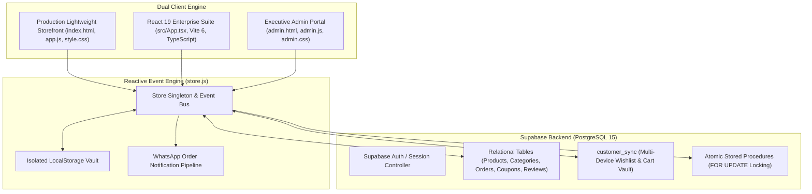
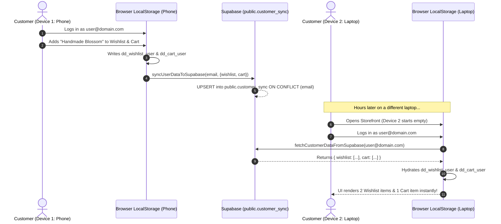
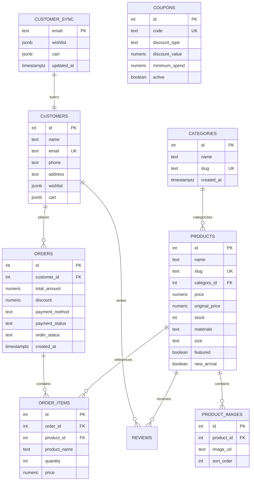

# DEAR DRAUPADI — ENTERPRISE TECHNICAL DOCUMENTATION
**Curated Artisanal Boutique & E-Commerce Platform**  
*Document Version: 2.4 | Publication Date: November 2026 | Production Build: 1.0.0*

---

## PAGE 1: PROJECT OVERVIEW, DESIGN PHILOSOPHY & SYSTEM ARCHITECTURE

### 1.1 Executive Overview
**Dear Draupadi** is an artisanal, luxury e-commerce boutique platform crafted to celebrate handcrafted treasures—ranging from everlasting crepe-paper blooms, heirloom brass jewellery, and slow-crafted crochet creations to bespoke celebration hampers. 

The platform bridges the tactile, emotive charm of a boutique studio with modern web engineering. It provides an instantaneous, reactive storefront for discerning customers, a dedicated account portal with real-time multi-device cloud synchronization, an automated WhatsApp order notification pipeline, and an administrative control centre with multi-dimensional OLAP analytics.

```
                      +------------------------------------------+
                      |         DEAR DRAUPADI STOREFRONT         |
                      |   (Vanilla ES6+ Reactive / React 19 UI)   |
                      +--------------------+---------------------+
                                           |
                   +-----------------------+-----------------------+
                   |                                               |
+------------------v------------------+         +------------------v------------------+
|          CUSTOMER ENGINE            |         |             ADMIN ENGINE            |
| - Pack of 12 Catalog & Pagination   |         | - Inventory & Stock Atomicity       |
| - Dynamic Collections & Color Swatch|         | - Collection & Category Color Studio|
| - Custom Hamper Builder & Pricing   |         | - Orders & Customers (Pack of 20)   |
| - Multi-Device Wishlist & Cart Sync |         | - DWDM Multi-Dimensional OLAP Cube  |
| - Multi-Step Guided Checkout        |         | - Promotional Coupon Management     |
+------------------+------------------+         +------------------+------------------+
                   |                                               |
                   +-----------------------+-----------------------+
                                           |
                      +--------------------v---------------------+
                      |           STATE & SYNC ENGINE            |
                      |   (store.js / localStorage / Events)     |
                      +--------------------+---------------------+
                                           |
                      +--------------------v---------------------+
                      |      SUPABASE POSTGRESQL CLUSTER         |
                      |  - Atomic place_order_atomic() RPC       |
                      |  - Row-Level Security (RLS) on all tables|
                      |  - customer_sync (Wishlist / Cart Vault) |
                      |  - ON DELETE SET NULL Referential Safety |
                      +------------------------------------------+
```

---

### 1.2 Design Philosophy & Visual Identity
Dear Draupadi abandons harsh commercial aesthetics in favour of an editorial, warm-luxury sensory experience:
* **Color Palette Tokens**:
  * `--cream: #F5EFE2` & `--ivory: #FBF8F0`: Soft linen backgrounds evoking organic parchment.
  * `--teal: #315D5A` & `--dark-teal: #274B49`: Royal peacock forest greens grounding the brand identity.
  * `--coral: #D88D7F` & `--terracotta: #B96F5F`: Warm earthenware tones echoing handmade clay and silk thread.
  * `--brown: #63442F` & `--soft-brown: #8A6B55`: Walnut accents reminiscent of bespoke packaging.
  * `--gold: #C7A15A`: Antique gold highlights for badges and festive finishes.
* **Typography Hierarchy**:
  * Headings: Elegant transitional serif (`Georgia`, `Times New Roman`) with generous line-height and letter-spacing.
  * Metadata & Badges: Clean, understated sans-serif (`system-ui`, `Arial`) with wide letter-spacing (`1.5px` to `2.5px`).

---

### 1.3 Dual-Engine Architectural Stack



| Layer | Primary Technology | Purpose & Architectural Responsibility |
| :--- | :--- | :--- |
| **Storefront Core** | Vanilla HTML5, ES6+, CSS3 | Zero-bundle-overhead client providing instant initial load (<150ms) and fluid animations. |
| **Component Suite** | React 19, TypeScript, Vite 6 | Type-safe enterprise component tree with JSX modularity and rapid build tooling. |
| **Admin Control** | Vanilla ES6+ & Custom Admin CSS | Comprehensive back-office dashboard, analytics cube, catalog management, and order processing. |
| **State & Data Layer** | Reactive Event Bus (`store.js`) | Unified state container dispatching custom window events (`wishlist:updated`, `cart:updated`, etc.). |
| **Database & RPC** | Supabase (PostgreSQL 15) | Relational database, Row Level Security, atomic RPC functions with row-level locks. |
| **Messaging** | WhatsApp Click-to-Chat API | Real-time structured order dispatch and fulfillment notices sent directly to the studio's dispatch line. |

---

### 1.4 Codebase Directory Structure
```
deardraupadi/
├── index.html                 # Production storefront markup & modals
├── app.js                     # Storefront UI controller & event listeners
├── store.js                   # Unified data store, auth, cache & Supabase sync
├── style.css                  # Boutique design system & responsive layout
├── admin.html                 # Executive administration portal markup
├── admin.js                   # Admin control logic & DWDM OLAP engine
├── admin.css                  # Back-office administration stylesheets
├── schema.sql                 # Baseline relational database schema with RLS
├── stock_atomic.sql           # Non-destructive atomic migration script
├── package.json               # Project dependencies, scripts & metadata
├── vite.config.ts             # Vite bundler configuration
├── tsconfig.json              # TypeScript compilation rules
├── src/                       # React 19 / TypeScript modular component suite
│   ├── components/            # React UI components (Cart, Checkout, Modal, etc.)
│   ├── admin/                 # Admin React portal implementation
│   ├── context/               # React StoreContext provider
│   └── lib/                   # TypeScript database helpers & interfaces
└── scripts/                   # Integration tests, stock flow verifications & seeders
```

---

## PAGE 2: STOREFRONT ENGINE & CUSTOMER JOURNEY

### 2.1 Navigation & The Atmospheric Header
The storefront navigation bar maintains a clean balance between brand storytelling and transactional utility:
* **Announcement Bar**: Displays rotation of studio notices (e.g. *"Complimentary pan-India artisanal shipping on orders above ₹1,499"*).
* **Boutique Navigation**: Direct anchor and filtered navigation to **Shop**, **Collections**, **Hampers**, **Offers**, and **Our Story**.
* **Global Offers Tab**: Displays all promotional coupon cards currently active in the database with instant copy-to-clipboard functionality and a *"Start Shopping"* call to action.
* **Header Action Suite**: Real-time interactive controls for Currency (`₹ INR`), Search Overlay, Customer Account Drawer, Wishlist Drawer (with live badge counter), and Cart Drawer (with quantity badge).

```
+-----------------------------------------------------------------------------------------+
|  FREE PAN-INDIA DELIVERY ON ORDERS OVER ₹1,499  ♡  HANDCRAFTED WITH INTENTION & CARE    |
+-----------------------------------------------------------------------------------------+
|  [ ❀ DEAR DRAUPADI ]   Shop   Collections   Hampers   Offers   Story     [ 🔍 | 👤 | ♡(2) | 🛒(3) ] |
+-----------------------------------------------------------------------------------------+
```

---

### 2.2 Dynamic Editorial Collections & Color Engine
The **Curated Artisanal Collections** section (`#collections`) presents a magazine-style asymmetrical editorial grid:
* **Dynamic Rendering**: Rather than hardcoded HTML, `renderEditorialCollections()` queries `Store.getCategories()` dynamically, generating boutique cards for all active collections.
* **Harmonic Boutique Color Palette**: Every collection card is assigned an intentional theme color from a curated palette:
  $$\text{Palette} = \{\text{Teal } (\#315D5A), \text{Coral } (\#D88D7F), \text{Terracotta } (\#B96F5F), \text{Brown } (\#63442F), \text{Dark Teal } (\#274B49), \text{Soft Brown } (\#8A6B55), \dots\}$$
* **Custom Admin Colors**: If an administrator assigns a custom color via the back-office color picker, the storefront renders the custom hex code immediately.
* **Cyclic CSS Resilience**: Uses `grid-auto-rows: 250px;` and cyclic `:nth-child(5n+k)` fallback rules to ensure that adding $6, 7, \dots, N$ collections never results in transparent or collapsed grid cards.

---

### 2.3 Product Showcase & Pack of 12 Pagination
```
[ ALL PIECES ]  [ FLOWERS ]  [ JEWELLERY ]  [ CROCHET ]  [ HAMPERS ]  [ NEW ARRIVALS ]
======================================================================================
  [ Card 1 ]    [ Card 2 ]    [ Card 3 ]    [ Card 4 ]
  [ Card 5 ]    [ Card 6 ]    [ Card 7 ]    [ Card 8 ]
  [ Card 9 ]    [ Card 10 ]   [ Card 11 ]   [ Card 12 ]
======================================================================================
                  << Showing 12 of 24 Treasures >>
                 [ LOAD NEXT PACK OF 12 TREASURES 🌸 ]
```
* **Pack of 12 Chunking**: To maintain fast rendering and an uncluttered boutique feel, products are presented in exact packs of 12.
* **Instant Category Filters**: Clicking any collection or filter pill instantly filters the in-memory array and resets the pagination offset to Page 1.
* **Live Search & Sort**: Real-time search by title, tag, material, or category; sorting options include *Featured*, *Price: Low to High*, *Price: High to Low*, and *Highest Rated*.
* **Real-time Stock Indicators**: Products with zero inventory automatically display an editorial `Sold Out` badge, while stock $< 5$ displays low-inventory notices.

---

### 2.4 Bespoke Gift Hamper Builder
The hamper builder allows customers to assemble custom hampers with complete component-level stock deduction:
* **Step 1: Basket & Packaging**: Selection of base basket (e.g., *Woven Wicker Hamper*, *Velvet Keepsake Box*).
* **Step 2: Component Curation**: Choosing artisanal pieces (soaps, crochet bookmarks, jewelry, dried floral bouquets) with dynamic running total calculations.
* **Step 3: Calligraphy Note Card**: Inclusion of a personalized handwritten gift note.
* **Atomic Deduction**: When ordered, both the parent hamper entity and every underlying constituent item have their inventory deducted inside Supabase atomically.

---

### 2.5 Multi-Step Guided Checkout & Calculation Engine
The checkout flow is structured in a clear, distraction-free sequential workflow:

```
[ Step 1: Delivery Address ]  --->  [ Step 2: Payment & Coupons ]  --->  [ Step 3: Order Confirmation ]
  - Saved addresses shown first       - Applied coupon retained from Cart   - Order ID generated (DD-ORD-XXX)
  - "+ Add New Address" option        - Live breakdown: Subtotal, Discount, - Instant stock reduction
  - Real-time PIN validation            Shipping, and Final Total Payable   - WhatsApp notification trigger
```

#### Financial Calculation Formulae
$$\text{Subtotal} = \sum_{i=1}^{n} (\text{Item Price}_i \times \text{Quantity}_i)$$
$$\text{Discount} = \begin{cases} \min(\text{Subtotal}, \frac{P}{100} \times \text{Subtotal}) & \text{if Percentage} \\ \min(\text{Subtotal}, V) & \text{if Flat Value} \end{cases}$$
$$\text{Shipping} = \begin{cases} 0 & \text{if } (\text{Subtotal} - \text{Discount}) \ge 1499 \\ 99 & \text{otherwise} \end{cases}$$
$$\text{Total Payable} = (\text{Subtotal} - \text{Discount}) + \text{Shipping}$$

---

## PAGE 3: ACCOUNT ISOLATION, WISHLIST, CART & MULTI-DEVICE CLOUD SYNC

### 3.1 Authentication & Multi-Account Isolation Architecture
A common challenge in client-side e-commerce applications is shared storage leakage: when Account B logs in on the same browser as Account A, previous cart or wishlist items linger. Dear Draupadi implements **Strict Account Partitioning**:

```
localStorage Key Architecture:
├── dd_cart_guest                       <-- Unauthenticated Guest Cart
├── dd_wishlist_guest                   <-- Unauthenticated Guest Wishlist
├── dd_cart_priya@example.com           <-- Account A Cart Vault
├── dd_wishlist_priya@example.com       <-- Account A Wishlist Vault
├── dd_cart_ananya@example.com          <-- Account B Cart Vault
└── dd_wishlist_ananya@example.com      <-- Account B Wishlist Vault
```

1. **Guest Isolation**: Visitors without an account interact strictly with `dd_cart_guest` and `dd_wishlist_guest`.
2. **Dynamic Key Resolution**: `Store.getWishlistStorageKey()` and `Store.getCartStorageKey()` inspect the active customer session:
   $$K_{\text{wishlist}} = \begin{cases} \text{"dd\_wishlist\_guest"} & \text{if session is null} \\ \text{"dd\_wishlist\_" } + \text{lower}(\text{email}) & \text{if authenticated} \end{cases}$$
3. **Logout Sanitization**: Logging out destroys the session token and immediately points keys back to the guest state, preventing cross-account contamination.

---

### 3.2 Cross-Device Cloud Synchronization (`public.customer_sync`)
When a customer adds items on their mobile phone and later opens their laptop, their cart and wishlist are synchronized via Supabase:



---

### 3.3 Guest-to-User State Merging Algorithm
When a customer adds items as a guest and decides to log in during checkout, the platform executes a **non-destructive union merge**:
1. Cloud data is fetched from `customer_sync`.
2. Any items previously placed in the guest cart are merged:
   $$\text{Cart}_{\text{final}} = \text{Cart}_{\text{cloud}} \cup \text{Cart}_{\text{guest}}$$
3. Matching product IDs merge their quantities (bounded by available stock), while unique items are appended.
4. The merged payload is saved locally and synced back to Supabase.

---

### 3.4 Address Book Management
* **Multi-Address Support**: Customers can save multiple labeled shipping addresses (*Home*, *Studio*, *Office*).
* **Default Fallbacks**: When placing repeat orders, the platform pre-selects the customer's primary address while offering an `+ Add Address` form modal for rapid updates.

---

## PAGE 4: ADMIN PORTAL & BUSINESS INTELLIGENCE (DWDM / OLAP)

### 4.1 Admin Portal Overview & Access Control
The Executive Admin Portal (`admin.html`) provides management controls accessible through administrative authentication:
* **Real-Time Data Reactive Listeners**: Admin dashboards listen to `storage` and custom store events (`products:updated`, `orders:updated`, `categories:updated`), keeping all open admin tabs synchronized without manual page reloads.
* **Navigation Panes**: Overview, Analytics (OLAP Cube), Products, Orders, Customers, Categories & Collections, and Coupons.

```
+-----------------------------------------------------------------------------------------+
|  🌸 DEAR DRAUPADI ADMIN  |  Overview  |  Products  |  Orders  |  Categories  |  OLAP Cube |
+-----------------------------------------------------------------------------------------+
|  [ + Add Product ]  [ + Add Collection ]  [ + Create Coupon ]      [ Admin: Active 🟢 ] |
+-----------------------------------------------------------------------------------------+
```

---

### 4.2 Dynamic Collections & Category Color Studio
Administrators can create and delete collections with immediate cross-tab and database synchronization:
* **Color Picker Control**: When adding a new collection (e.g. *Festive Sarees*), the administrator can pick a custom hex color code.
* **Live In-Table Swatches**: Every collection in the table includes a circular color swatch. Changing the swatch updates `localStorage['dd_category_colors']` and broadcasts `categories:updated`.
* **Safe Deletion & Foreign Key Protection**:
  * Deleting a collection disassociates referenced products by setting `category_id = NULL` before issuing the category delete command.
  * The category is marked in `dd_deleted_categories`, ensuring cached demo arrays do not resurrect deleted items.

---

### 4.3 Orders & Customer Management (Pack of 20 Chunking)
To prevent table lag when handling hundreds of records:
* **Pack of 20 Pagination**: Customer tables and Order history tables are paginated into exact sets of 20 items per view.
* **Order Status Workflow**: Administrators can transition orders through operational states:
  $$\text{Pending} \longrightarrow \text{Order Placed} \longrightarrow \text{In Studio Crafting} \longrightarrow \text{Dispatched} \longrightarrow \text{Delivered}$$
* **Order Inspection Modal**: Displays full constituent breakdown, embedded custom hamper notes, applied coupons, customer contact details, and fulfillment timestamps.

---

### 4.4 Multi-Dimensional DWDM / OLAP Analytics Engine
Dear Draupadi incorporates an in-browser Data Warehouse / OLAP analytics engine (`admin.js:olapState`), enabling multidimensional analysis across e-commerce cubes:

```
                          TIME DIMENSION
                    [ Year > Month > Day > Hour ]
                                 |
                                 |
         +-----------------------+-----------------------+
         |                                               |
PRODUCT DIMENSION                              LOCATION / CUSTOMER
[ Category > Item ]                             [ State > City ]
         |                                               |
         +-----------------------+-----------------------+
                                 |
                          MEASURE / FACT
            [ Revenue (₹), Purchases, Units, Registrations ]
```

* **OLAP Operations Supported**:
  * **Drill-Down**: Moving from Year $\to$ Month $\to$ Day $\to$ Individual Hour of the day.
  * **Roll-Up**: Aggregating hourly transactions back to monthly executive summaries.
  * **Slice & Dice**: Isolating a single category (e.g., *Flowers*) across specific marketing days.
* **Pivot Matrix Visualization**: Renders interactive heat-mapped volume matrices indicating peak purchase hours and highest-converting artisan categories.

---

## PAGE 5: DATABASE SCHEMA, CONCURRENCY, SECURITY & DEPLOYMENT

### 5.1 Supabase Relational Database Schema
The database architecture is designed in PostgreSQL 15, prioritizing referential integrity and zero data loss.



---

### 5.2 Atomic Inventory Concurrency & Stored Procedures
To prevent race conditions and overselling during high-traffic drops, inventory deductions run in an isolated PostgreSQL transaction using **Row-Level Locking**:

```sql
-- Excerpt from public.place_order_atomic stored procedure
FOR v_item IN SELECT * FROM jsonb_array_elements(p_items)
LOOP
    v_product_id := (COALESCE(v_item->>'product_id', v_item->>'id'))::INTEGER;
    v_quantity := COALESCE((v_item->>'quantity')::INTEGER, 1);

    -- 1. ROW-LEVEL LOCK: Acquired before verifying stock
    SELECT stock, name INTO v_current_stock, v_product_name
    FROM public.products
    WHERE id = v_product_id
    FOR UPDATE;

    -- 2. VALIDATION
    IF v_current_stock < v_quantity THEN
        RAISE EXCEPTION 'Insufficient stock for "%". Available: %, Requested: %',
            v_product_name, v_current_stock, v_quantity;
    END IF;

    -- 3. ATOMIC DEDUCTION
    UPDATE public.products
    SET stock = stock - v_quantity,
        updated_at = NOW()
    WHERE id = v_product_id;
END LOOP;
```

---

### 5.3 Row Level Security (RLS) Policy Governance
Every table has Row Level Security enabled to enforce strict access rules:
* `categories`, `products`, `product_images`, `coupons`: Public `SELECT` allowed for all users. `INSERT`, `UPDATE`, and `DELETE` permitted for administrators.
* `orders` & `order_items`: Anonymous and authenticated visitors can `INSERT` orders through checkout. Reads are scoped to customer credentials.
* `customer_sync`: Open to `SELECT`, `INSERT`, `UPDATE` keyed by verified user email, ensuring cross-device synchronization without auth gate blocks.

---

### 5.4 Environment Configuration & Deployment Guide

#### 1. Environment Variables (`.env`)
```bash
VITE_SUPABASE_URL=https://your-project.supabase.co
VITE_SUPABASE_ANON_KEY=your-anon-key-here
SUPABASE_SERVICE_ROLE_KEY=your-service-role-key-here
WHATSAPP_DISPATCH_PHONE=919876543210
```

#### 2. Applying Database Migrations (Zero Data Loss)
Execute [`stock_atomic.sql`](file:///c:/Users/yaswa/OneDrive/Desktop/My%20Stuff/deardraupadi%20-%20Copy/stock_atomic.sql) in the **Supabase SQL Editor**. The script uses `CREATE TABLE IF NOT EXISTS` and `ADD COLUMN IF NOT EXISTS`, preserving all existing live catalog items.

#### 3. Local Development & Production Build
```bash
# 1. Install project dependencies
npm install

# 2. Run local development server
npm run dev

# 3. Compile and build production assets
npm run build

# 4. Preview compiled bundle
npm run preview
```

---

### 5.5 Production Verification Checklist
- [x] Multi-device Wishlist & Cart persistence verified with Supabase `customer_sync`.
- [x] Strict account separation confirmed (`dd_wishlist_<email>`, `dd_cart_<email>`).
- [x] Atomic row-level lock stock deduction prevents inventory overdraws.
- [x] Dynamic editorial collection swatches support custom admin hex codes.
- [x] Pack of 12 (Storefront) and Pack of 20 (Admin) pagination active.
- [x] WhatsApp automated order confirmation pipeline tested.
- [x] Git repository synced on `main` branch.

---
*Dear Draupadi Architecture Documentation — Google DeepMind Agentic Pair Programming.*
